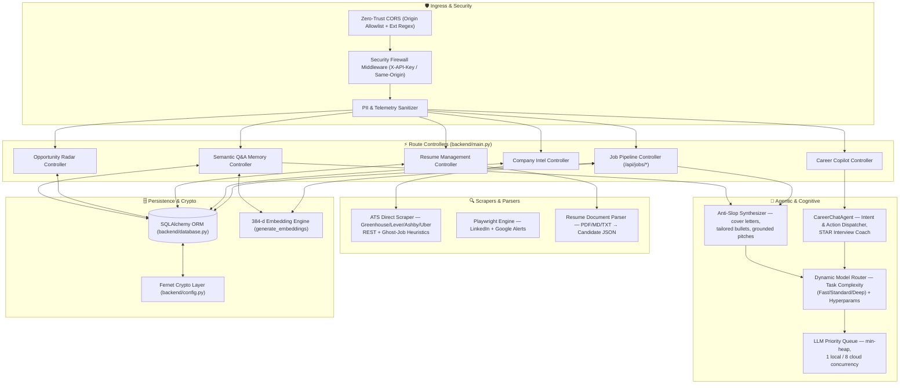
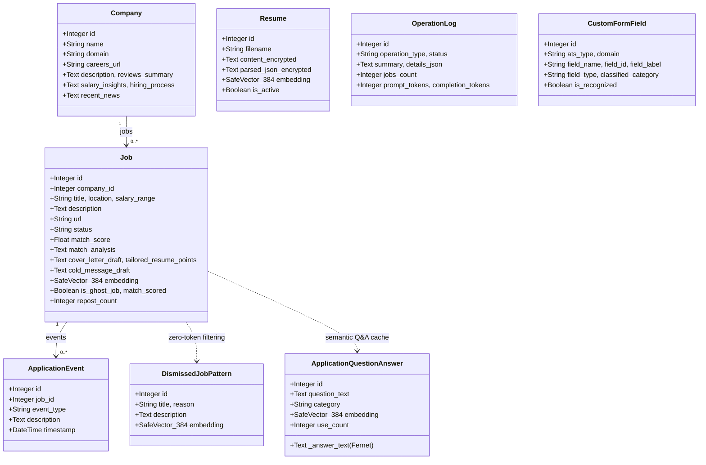

# AI/FDE System Design Deep Dive — Notes & Diagrams

Two deliverables:
1. **Part A — From-memory delivery version** (memory-safe, no file lookups): compress the narrative + reasoning into a version you can practice and deliver verbally.
2. **Part B — Ready-to-paste Mermaid C4 blocks** for the written/diagram deliverable.

---

# Part A — From-Memory Delivery Version

## Narrative (rehearse in this order, ~40 lines)

**Opener / problem.**
> Job hunting is high-volume, low-signal: 100+ recruiter emails/week, manual screening, 20–30 min of tailoring per role. My system automates discovery, ranks by fit, and assists the application — locally, never auto-submitting. The core research question: given a resume and a JD, predict fit *and explain why* — fast, cheap, and accurately.

**Journey arc (the story they'll remember).**
- Started as an N8N + Gmail prototype → too limited → rewrote as a local-first agent with multi-source ingestion (ATS portals, LinkedIn, Google Jobs, Gmail).
- **Naive Phase 2:** full LLM for every job → 5–15 s, ~1000 tokens each; scanning 50 jobs blocked the UI for 4–10 minutes.
- **Phase 3 crisis:** "Why does Reprocess All take 10 minutes?" Root cause: redundant LLM extraction (feature extraction + requirements were identical across jobs).
- **Phase 4 breakthrough — the pivot to tell:** **Hybrid classifier**. Deterministic fast path (<100 ms, 0 tokens: heuristic rules, optional logistic-regression ML) + deferred LLM narrative on demand (progressive disclosure). ~90–99% token savings; 50-job scan drops from minutes to <5 s.
- **Phase 5:** on-demand detailed analysis + semantic caching (cache-first answers ≈ 0 tokens).

**C4 map (4 levels).**
- **L1 Context:** Candidate ↔ System ↔ external platforms (LinkedIn, ATS, Google Jobs/Gmail) ↔ AI inference (local LM Studio/Ollama/Unsloth; opt-in cloud OpenAI/Gemini/Anthropic).
- **L2 Containers:** vanilla-JS SPA + Chrome MV3 extension → FastAPI backend + Playwright daemon → SQLite/PostgreSQL(pgvector) + Fernet vault → local/cloud inference.
- **L3 Components:** ingress security middleware → route controllers (jobs/companies/resume/radar/QA/chat) → cognitive agents (CareerChatAgent, dynamic model router, anti-slop engine, priority queue) → ingestion engines (ATS scrapers, Playwright, parser) → persistence.
- **L4 Entities:** Job, Company, Resume, ApplicationEvent, OperationLog, ApplicationQuestionAnswer, DismissedJobPattern, CustomFormField, ProcessedEmail, UserPreference.

**Agentic reasoning stack (5 layers).**
1. Deterministic perception (dedup, geo filter, ghost-job heuristics, zero-token semantic dismissal).
2. Task classification: task_type → FAST/STANDARD/DEEP + sampling params.
3. LLM reasoning: schema-constrained structured generation (Pydantic V2).
4. Verifier/optimizer: LLM-as-judge grounding + anti-slop.
5. Deterministic post-processing: sanitize, variable-adapt, semantic auto-cache.

**Cost/perf engineering.**
- Dynamic concurrency queue (min-heap): 1 worker/0.2 s pacing local (protect 18 GB VRAM), 8 workers cloud.
- Zero-token filters: semantic dismissal (0.80), essay cache (0.85), deterministic-first bulk scoring.
- Observability: dual-sink logging, OperationLog token accounting, per-inference telemetry, real-time cost analytics.

**Autonomy & safety (close strong).**
- Autonomy Level 4 (autonomous agent) but human-in-the-loop: never auto-submit (`submission_confirmed`).
- No-fabrication contract: failures return `None`/error, never invented values; `match_scored=False` cue = "not AI-scored".
- Prompt-injection boundary (`wrap_untrusted`), output sanitization, isolated browser profile, opt-in flags, Fernet encryption at rest.
- **Closing line:** "Don't use an LLM when a heuristic or lightweight ML classifier will do. LLMs are for the 10% of work that needs semantic depth; everything else must be fast and cheap."

## Reasoning (recite in ~10 bullets)
1. **FastAPI** — async SSE streaming, Pydantic V2 structured outputs, DI; fits the API gateway + background task engine.
2. **Hybrid scoring over pure LLM** — cost & latency dominate, not accuracy; defer the expensive 10% only.
3. **Heuristic-first over ML-first** — reproducible, debuggable, zero-dep (~70%); optional logistic regression (interpretable, small-data) → ~85%.
4. **Regex+taxonomy over LLM-as-extractor** — feature extraction must be deterministic & free in the hot path.
5. **SQLAlchemy + SafeVector** — single ORM for SQLite→PostgreSQL/pgvector; auto-ALTER migrations without data loss.
6. **Playwright** for no-public-API sites (LinkedIn/Gmail/Workday); REST scrapers for documented ATS.
7. **Local-first, cloud opt-in** — privacy + zero cost on M3; cloud for deep reasoning + 8-way batch.
8. **Pydantic schemas + LLM-as-judge verifier** — tames hallucination in deterministic scoring (the Gemini lesson).
9. **Embeddings + semantic cache (0.80–0.85)** — RAG-lite memory cuts redundant inference.
10. **Vanilla JS SPA + MV3 extension** — no build step, easy side-panel autofill, graceful offline Gemini Nano fallback.

---

# Part B — Ready-to-Paste Mermaid C4 Blocks

## L1 — System Context
```mermaid
flowchart TB
    Candidate["👤 Candidate / Job Seeker"]
    subgraph Sys ["📦 Job Alert Agent System (Local & Autonomous)"]
        Core["🤖 Job Alert Agent Platform<br/>Discovery & Ingestion · ATS Match Scoring ·<br/>In-DOM Autofill · AI Career Copilot"]
    end
    subgraph Ext ["🌐 External Platforms"]
        LI["💼 LinkedIn<br/>Alerts, Saved Jobs, Recommendations"]
        ATS["🏢 ATS Portals<br/>Greenhouse, Lever, Ashby, SmartRecruiters,<br/>Workable, Workday, Uber"]
        GJ["🔍 Google for Jobs & Gmail"]
    end
    subgraph Inf ["🧠 AI & Reasoning Providers"]
        Local["🖥️ Local Inference<br/>LM Studio :1234 / Ollama :11434 / Unsloth :8008"]
        Cloud["☁️ Cloud (Opt-In)<br/>OpenAI / Gemini / Anthropic"]
    end
    Candidate <-->|Manage, scan, inspect, chat| Core
    Core <-->|Scrape alerts & saved jobs, unwrap links| LI
    Core <-->|Scrape boards, inspect/autofill forms| ATS
    Core <-->|Ingest query alerts & email digests| GJ
    Core <-->|Local reasoning (1-worker VRAM pacing)| Local
    Core <-->|High-throughput batch (8 parallel)| Cloud
```

## L2 — Containers
```mermaid
flowchart TB
    Candidate["👤 Candidate / User"]
    subgraph Client ["🖥️ Client Layer"]
        SPA["🌐 Frontend SPA (Vanilla JS)<br/>Kanban · Token & Cost Analytics · Radar · Copilot"]
        Ext["🧩 Chrome Extension (MV3)<br/>Content Scripts · Service Worker · Side Panel ·<br/>Runtime Adapter (Connected vs Standalone)"]
    end
    subgraph Backend ["⚡ Backend (FastAPI / Python)"]
        API["🚀 FastAPI Gateway & Agent Runtime<br/>REST · CORS & API-Key Firewall ·<br/>Model Router · Priority Queue · Anti-Slop Engine"]
        PW["🎭 Playwright Daemon<br/>Persistent profile · LinkedIn/Google/ATS ·<br/>Redirect & ATS Link Unwrapper"]
    end
    subgraph Store ["🗄️ Storage & Crypto Vault"]
        DB[("🗄️ Database & Vector Memory<br/>PostgreSQL(pgvector) / SQLite · 384-d vectors")]
        Vault[("🔐 Key Vault (.key/.api_key)<br/>Fernet cipher · system token")]
    end
    subgraph ExtSvc ["🌐 External & AI Services"]
        Linf["🖥️ Local Infer (LM Studio/Ollama/Unsloth)"]
        Cinf["☁️ Cloud APIs (OpenAI/Gemini/Anthropic)"]
        Web["🌍 Portals (Greenhouse, Lever, LinkedIn, ...)"]
    end
    Candidate --> SPA
    Candidate --> Ext
    SPA -->|REST same-origin| API
    Ext -->|REST + X-API-Key| API
    Ext -->|Inject autofill & inspect| Web
    API <-->|Controls workflows| PW
    PW <-->|Navigates with cookies| Web
    API <-->|ORM & vectors| DB
    API <-->|Cipher & tokens| Vault
    API <-->|Paced inference (0.2s cooling)| Linf
    API <-->|Concurrent batching (8 workers)| Cinf
```

## L3 — Component (Backend Gateway)


## L4 — Entity / Class Diagram


---

_Source: `PORTFOLIO_JOURNEY.md`, `AGENTIC_ARCHITECTURE.md` §5, `DESIGN_DIAGRAMS.md` §16, `LESSONS_LEARNED.md`._
_Generated for AI/FDE System Design deep-dive prep._
